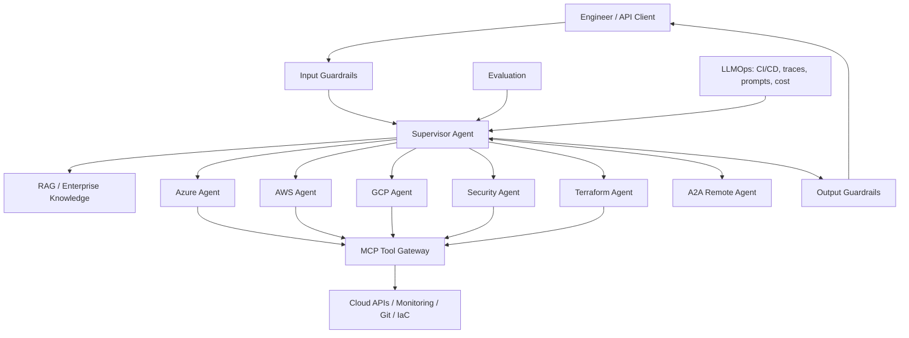

# Multi-Cloud Agentic AI Operations Copilot — Phase 2

Production-oriented portfolio reference showing **RAG + Single Agent + Multi-Agent + LLMOps + Guardrails/Evaluation + MCP + Agent-to-Agent (A2A)** across Azure, AWS and GCP concepts.

## Architecture




## Phase 2 additions
- **LangGraph-ready orchestration** with local fallback for offline tests.
- **Model provider abstraction:** Azure OpenAI, Amazon Bedrock, Google Vertex AI, or local demo mode.
- **A2A endpoints:** agent card plus typed task endpoint.
- **Managed-vector extension interface** for Azure AI Search/OpenSearch/Vertex-backed retrieval.
- **Tracing hook** for latency/span instrumentation and an OpenTelemetry upgrade path.
- **Human approval boundary** remains enforced at the MCP tool gateway.

See `architecture/phase2.md` and `.env.example`. No secrets are included.

## What this demonstrates
- **RAG:** local reference retriever over approved runbooks; swap with Azure AI Search, Amazon OpenSearch, or Vertex/vector backend.
- **Agent:** specialist agent uses retrieved evidence and controlled tools.
- **Multi-Agent:** supervisor routes to Azure, AWS, GCP, Security and Terraform specialists.
- **LLMOps:** tests + automated evaluation in GitHub Actions; extension points for tracing, prompt/model registry, latency and cost.
- **Guardrails/Evals:** prompt-injection screening, write-tool approval, regression dataset and quality gate.
- **MCP/A2A:** tool registry with approval semantics plus typed inter-agent task messages.

## Quick start
```bash
python -m venv .venv
source .venv/bin/activate   # Windows: .venv\\Scripts\\activate
pip install -r requirements.txt
cp .env.example .env
uvicorn app.main:app --reload
```
Open `http://localhost:8000/docs`.

## Demo
```bash
curl -X POST http://localhost:8000/ask -H 'content-type: application/json' -d '{"question":"Review Azure private connectivity and Terraform controls"}'
curl http://localhost:8000/mcp/tools
curl http://localhost:8000/eval
```

## Production roadmap
1. Replace reference retrieval with embeddings + managed vector search and metadata/ACL filtering.
2. Connect an LLM provider (Azure OpenAI / Bedrock / Vertex AI) behind a provider abstraction.
3. Replace keyword routing with a graph-based orchestrator (for example LangGraph) and durable state/checkpoints.
4. Implement the official MCP SDK and OAuth/workload identity; expose read-only tools first.
5. Implement an A2A-compatible agent card/task endpoint and authentication for remote agents.
6. Add OpenTelemetry traces, token/cost/latency dashboards, prompt/model versioning and offline/online evals.
7. Deploy with Terraform into isolated dev/test/prod environments; secrets stay in cloud secret managers.

## Safety model
Read-only operations can execute automatically. Any write/destructive tool returns `approval_required` unless explicit approval is supplied. Never place cloud keys in source control; use workload identity/managed identity/IAM roles.

## Interview story
Use the repo to explain the lifecycle: ingest trusted knowledge → retrieve evidence → supervisor delegates → specialists use controlled MCP tools → A2A delegates externally when required → guardrails protect inputs/actions/outputs → evaluation and LLMOps continuously test quality, safety, latency and cost.

---

# Phase 3 — Cloud-deployable portfolio extension

Phase 3 upgrades the reference platform with production integration seams while preserving a credential-free local demo.

## Added in Phase 3

- **Azure AI Search adapter** for enterprise/vector RAG with local fallback.
- **Read-only Azure/AWS/GCP cloud tool adapters** that use DefaultAzureCredential, boto3, and Google Cloud SDK credentials when available.
- **Persistent checkpoint state** using SQLite locally; designed to be replaced by managed Postgres/Redis in production.
- **OpenTelemetry bootstrap** for request, agent, retrieval, tool, latency, token and cost telemetry.
- **Advanced evaluation quality gate** for groundedness, relevance and safety.
- **Terraform deployment roots** for Azure, AWS and GCP.
- **LLMOps dashboard definition** covering latency, token use, groundedness, tool success, guardrail blocks and estimated cost.
- **Production architecture** in `architecture/phase3.md`.

## Phase 3 deployment mapping

| Capability | Azure | AWS | GCP |
|---|---|---|---|
| LLM | Azure OpenAI | Amazon Bedrock | Vertex AI |
| Vector/RAG | Azure AI Search | OpenSearch Serverless | Vertex AI / vector store |
| Runtime | Container Apps / AKS | ECS/Fargate / EKS | Cloud Run / GKE |
| Secrets | Key Vault | Secrets Manager | Secret Manager |
| Telemetry | Azure Monitor/App Insights | CloudWatch/X-Ray | Cloud Logging/Trace |
| IaC | Terraform | Terraform | Terraform |

## Security model

Cloud tools are **read-only by default**. Never place credentials in the repository. Use workload identity/managed identity/IAM roles/service accounts. Destructive operations should be separate MCP tools protected by RBAC, policy, audit logging and explicit human approval.

## Portfolio demo path

1. Start locally with no credentials and demonstrate RAG, supervisor routing, guardrails, evaluation, MCP/A2A patterns and persistence.
2. Configure one provider first (recommended: Azure) and replace local retrieval with Azure AI Search.
3. Enable read-only inventory tools through workload identity.
4. Export traces/metrics with OpenTelemetry.
5. Run evaluation in CI before promotion.
6. Repeat the provider adapter pattern for AWS Bedrock/OpenSearch and GCP Vertex AI.

---
## Phase 4 — Azure live deployment
Phase 4 adds an Azure-first live deployment path: Container Apps, ACR, Azure OpenAI v1 Responses API, Azure AI Search, Key Vault, managed identity/RBAC, Application Insights, Terraform, and GitHub Actions OIDC. See `PHASE4.md`, `deployment/azure/`, and `architecture/phase4.md`.
