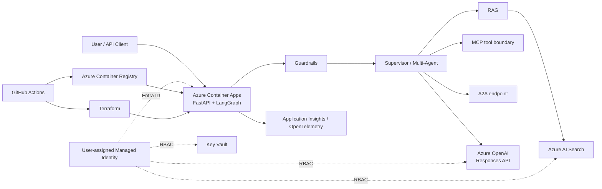

# Phase 4 — Azure live deployment architecture

## Security baseline
- Managed identity is the default application credential; no Azure OpenAI API key is required.
- Azure OpenAI local authentication is disabled in Terraform.
- AI Search local authentication is disabled.
- MCP cloud actions remain read-only by default; write/destructive operations require an explicit approval boundary.
- Production hardening: add VNet integration/private endpoints, private DNS, WAF/API gateway, Defender, diagnostic settings, and environment-specific policy controls.
